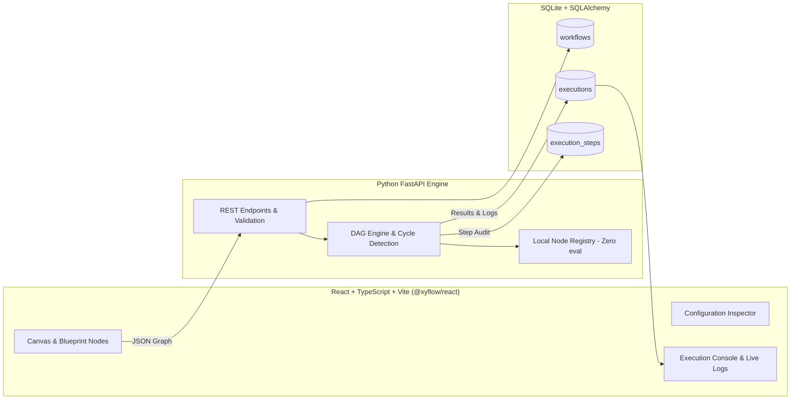

# NodeFlow — Visual Workflow Automation Platform
> **Day 20/365** | Local-First Visual Automation Platform with Python DAG Execution Engine

NodeFlow is a visual workflow automation platform designed with a distinctive **“Swiss Editorial meets Industrial Blueprint”** aesthetic. Connect nodes on a dotted blueprint grid, configure data pipelines, route execution through conditional logic, and execute workflows locally using a real Python FastAPI backend engine with SQLite persistence, cycle detection, and step-by-step auditing.

---

## 1. Product Vision & Architecture

NodeFlow enables users to author and execute multi-step automated workflows without writing boilerplate code or requiring external cloud subscriptions.



---

## 2. Art Direction: “Swiss Editorial meets Industrial Blueprint”

- **Main background:** Warm ivory (`#F7F5EF`)
- **Workspace panels:** Crisp white (`#FFFFFF`) with 1-pixel borders (`#E4E1D9`)
- **Primary text:** Near-black (`#20211F`)
- **Secondary text:** Muted technical grey (`#777970`)
- **Accents:** Electric orange (`#FF5A1F`) and Cobalt blue (`#315BDB`)
- **Status indicators:** Restrained forest green (`#1B7F48`) and clear red (`#D92D20`)
- **Typography:** Sans-serif interface (`Inter`), bold editorial display headings (`Space Grotesk`), and monospace node tags & log streams (`JetBrains Mono`).

---

## 3. Core Features

### A. Visual Workflow Editor (Canvas)
- **React Flow Canvas**: Drag-and-drop node placement on a dotted blueprint grid (`#DDD9CD`).
- **Technical Cards**: Headers with category tags (`[TRIGGER]`, `[INPUT]`, `[LOGIC]`, `[TRANSFORM]`, `[OUTPUT]`), custom icons, status badges (`IDLE`, `RUNNING`, `COMPLETED`, `FAILED`, `SKIPPED`), and handle ports.
- **Dedicated Condition Handles**: True (`green`) and False (`red`) branches with explicit routing tags.
- **Right Configuration Inspector**: Slide-out panel for live node parameter configuration and validation.
- **Bottom Execution Console**: Tabbed drawer with real-time logs, step-by-step timeline inspector, and copyable JSON output.
- **Undo / Redo & Validation**: Graph history undo/redo (`Ctrl+Z` / `Ctrl+Y`) and instant DAG cycle validation.

### B. Workflow Dashboard
- **Summary Metrics**: Live database statistics for total workflows, total executions, success rate %, and average latency.
- **Filter & Search**: Full-text search and category filter pills (`Transform`, `Logic`, `Customer Ops`, `Finance`).
- **Actions**: Create new blueprint, Quick Run directly against backend, Duplicate (`/duplicate`), and Delete with confirmation.

### C. Execution History
- **Audit Log**: Every workflow run is permanently stored in SQLite with start time, completion time, duration ms, and status.
- **Step Breakdown**: Inspect the exact inputs, outputs, branch decisions, and errors for every node executed in the DAG.
- **Cancellation**: Safe cancellation endpoint for queued/running executions.

---

## 4. Node Library (Local-First, Zero eval)

1. **Manual Trigger**: Starts workflow on demand with runtime ISO-8601 timestamp.
   ```json
   {
     "trigger": "manual",
     "timestamp": "2026-10-24T18:42:00Z",
     "payload": { "manual_run": true }
   }
   ```
2. **Text Input**: Configurable text field with variable naming and required field validation.
3. **Condition**: Evaluates `equals`, `not_equals`, `contains`, `not_contains`, `greater_than`, `less_than`, `is_empty`, or `is_not_empty` and routes down `True` or `False` handles.
4. **Text Transform**: Applies text modifications: `uppercase`, `lowercase`, `trim`, `replace`, `split_lines`, `slugify`, `capitalize`.
5. **Delay**: Configurable pause between operations strictly capped at a 5.0 second safety limit.
6. **Output**: Terminal node displaying final structured results with 1-click JSON clipboard copy.
7. **Notification Simulator**: Resolves dynamic variables (`{{text}}`, `{{timestamp}}`) and logs simulated dispatch receipts without external network dependencies.
8. **Mock API**: Local simulated REST endpoints (Users, Orders, Weather, Stocks).
9. **Sentiment Classifier**: Zero-dependency local lexicon sentiment scoring (Positive, Neutral, Negative).
10. **Math Operation**: Safe arithmetic calculations (+, -, *, /, %, round).

---

## 5. Starter Blueprints Included

- **A. Text Processor**: `Manual Trigger` → `Text Input` → `Text Transform` (uppercase/slugify) → `Terminal Output`
- **B. Conditional Router**: `Manual Trigger` → `Text Input` → `Condition Router` → `True Output` / `False Output`
- **C. Message Generator**: `Manual Trigger` → `Text Input` → `Text Transform` → `Notification Simulator` → `Terminal Output`
- **D. Customer Sentiment Pipeline**: `Manual Trigger` → `Text Input` → `Sentiment Analyzer` → `Condition` → `Slack Praise` / `Escalation`

---

## 6. Installation & Quickstart (Windows 11 & Cross-Platform)

### Prerequisites
- Python 3.10+ (Tested on Python 3.14)
- Node.js 18+ and npm

### Step 1: Clone and Enter Project
```powershell
cd c:\Users\speedy\Desktop\DAY4
```

### Step 2: Backend Setup
```powershell
# Navigate to backend directory
cd backend

# Install dependencies (FastAPI, Uvicorn, SQLAlchemy, Pydantic, pytest)
pip install -r requirements.txt

# Return to workspace root
cd ..
```

### Step 3: Frontend Setup
```powershell
# Navigate to frontend directory
cd frontend

# Install dependencies
npm install

# Return to workspace root
cd ..
```

---

## 7. Running the Application

Open two PowerShell windows:

### Terminal 1: Start Backend Engine
```powershell
cd c:\Users\speedy\Desktop\DAY4
python -m uvicorn backend.main:app --host 127.0.0.1 --port 8000 --reload
```
*Backend runs on `http://127.0.0.1:8000` (API docs at `http://127.0.0.1:8000/docs`).*

### Terminal 2: Start Frontend Dev Server
```powershell
cd c:\Users\speedy\Desktop\DAY4\frontend
npm run dev
```
*Frontend runs on `http://localhost:5173`.*

---

## 8. Running Automated Tests

Run the complete backend test suite covering CRUD, DAG validation, cycles, branching, and error handling:
```powershell
cd c:\Users\speedy\Desktop\DAY4
python -m pytest backend/tests -v
```

Run frontend build verification:
```powershell
cd c:\Users\speedy\Desktop\DAY4\frontend
npm run build
```

---

## 9. API Endpoint Reference

| Method | Endpoint | Description |
|---|---|---|
| `GET` | `/api/health` | Health check endpoint |
| `GET` | `/api/stats` | System metrics from database (workflows, runs, success rate) |
| `GET` | `/api/nodes/definitions` | Catalog of all registered node types |
| `GET` | `/api/templates` | List pre-built starter workflow templates |
| `POST` | `/api/templates/{id}/instantiate` | Clone starter template into user workflow |
| `GET` | `/api/workflows` | List workflows (supports `?q=` search and `?category=`) |
| `POST` | `/api/workflows` | Create a new workflow |
| `GET` | `/api/workflows/{id}` | Get workflow by ID |
| `PUT` | `/api/workflows/{id}` | Update workflow name, description, or graph |
| `DELETE` | `/api/workflows/{id}` | Delete workflow from database |
| `POST` | `/api/workflows/{id}/duplicate` | Duplicate an existing workflow with copy suffix |
| `POST` | `/api/workflows/{id}/execute` | Execute a saved workflow by ID |
| `POST` | `/api/workflows/execute-adhoc` | Execute an ad-hoc canvas graph directly |
| `POST` | `/api/workflows/validate` | Validate DAG structure, trigger presence, and cycles |
| `GET` | `/api/executions` | List execution history (supports `?status=` and `?workflow_id=`) |
| `GET` | `/api/executions/{id}` | Get detailed execution audit trace with step I/O |
| `POST` | `/api/executions/{id}/cancel` | Safely cancel an active execution |
| `DELETE` | `/api/executions/{id}` | Delete execution record |
| `DELETE` | `/api/executions` | Clear all execution history |

---

## 10. Reliability, Security & Design Decisions

1. **Zero `eval()` or `exec()`**: User inputs and formulas are processed strictly via deterministic Python functions and AST mathematical parsing. No arbitrary code execution is allowed.
2. **Kahn's DAG Cycle Detection**: Workflows are checked for cycles before execution. Any circular dependency is rejected with a clear explanation.
3. **Mandatory Trigger Verification**: Every executable workflow requires at least one trigger node.
4. **Conditional Routing Isolation**: Inactive conditional branches are strictly skipped during execution; skipped nodes do not execute and downstream nodes are skipped accordingly.
5. **Safe Delays**: Delay durations are validated and strictly capped at 5.0 seconds maximum.
6. **Notification Simulator Integrity**: Simulation nodes explicitly tag payloads with disclaimer headers so simulated alerts are never mistaken for real outbound network dispatches.

---

## 11. Known Limitations & Future Improvements

- **Scheduled & Cron Triggers**: Currently workflows are triggered manually or via ad-hoc testing. Background cron scheduling is a planned extension.
- **Sub-Workflows**: Future versions can introduce a Sub-Workflow node that encapsulates another workflow graph as a single reusable block.
- **Multi-user Authentication**: Intended as a local-first single-user developer tool; production multi-tenant deployment would require user auth layers (JWT/OAuth2).
